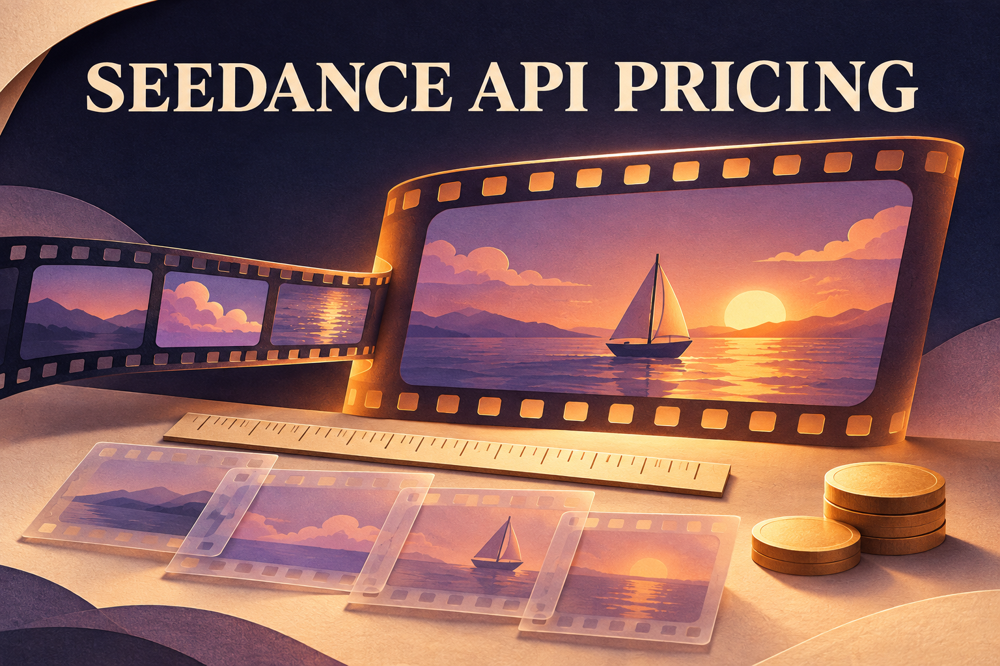

# Seedance API Pricing: Rates, References and Cost per Clip

Adding a five-second product video to an app sounds like a small expense. To estimate Seedance API pricing, specify the model, resolution and provider first. For example, BytePlus publishes an estimated $1.156 for a five-second, 720p, 16:9 Seedance 2.5 clip without video input.

Use that example as a starting point for a matching request. Reference footage can add billable usage, another provider can use a different charging rule, and several attempts may be needed before you keep a clip. Start with the rate for your intended version, then price the complete request and the candidates behind the finished video.



*Conceptual illustration of planning a video clip and its inputs; the tables and examples provide the pricing conditions.*

## Start with the exact Seedance version

The following are [BytePlus](https://docs.byteplus.com/en/docs/modelark/model-pricing) published estimates, checked November 6, 2026. All amounts are USD for **one five-second, 16:9 output with no video input**, using online inference. They are examples derived from video-token billing, not flat prices for every aspect ratio or a measured bill.

| Model and BytePlus ID | 480p | 720p | 1080p | 4K |
|---|---:|---:|---:|---:|
| Seedance 2.5 — `dreamina-seedance-2-5-260628` | $0.514 | $1.156 | $2.843 | Not supported |
| Seedance 2.0 — `dreamina-seedance-2-0-260128` | $0.35 | $0.76 | $1.87 | $3.89 |
| Seedance 2.0 Fast — `dreamina-seedance-2-0-fast-260128` | $0.28 | $0.60 | Not supported | Not supported |
| Seedance 2.0 Mini — `dreamina-seedance-2-0-mini-260615` | $0.18 | $0.38 | Not supported | Not supported |

The $0.38 Mini example is a five-second 720p request for that specific Mini model; it does not describe a 2.5 request. Likewise, the direct 2.0 4K option does not establish 4K support for 2.5. The price sheet marks offline inference unsupported for these 2.5 and 2.0-family rows; a discount for a different model or processing mode cannot simply be carried across.

Choose the version and output specification your feature needs before choosing its rate. This table focuses on 2.5 and the 2.0 family; older Seedance 1.0 and 1.5 offerings have their own conditions. Dreamina or CapCut subscription credits also belong to their respective app plans, so a consumer subscription price is not a quote for these API calls.

## Why a reference video changes the calculation

A reference video is footage supplied to guide a new generation. BytePlus bills video generation in video tokens: a unit based on the video being processed. Its estimate grows with frame size, frame rate and the combined length of input and output footage. That is different from counting the words in your prompt.

For a five-second 720p output at 1280 × 720 and 24 frames per second, with no video input, the calculation is:

```text
Estimated tokens = (input seconds + output seconds) × width × height × fps ÷ 1024
                 = (0 + 5) × 1280 × 720 × 24 ÷ 1024
                 = 108,000
Estimated cost   = 108,000 ÷ 1,000,000 × $10.70 = $1.1556
```

This reproduces the vendor's $1.156 example after rounding. Now suppose the request uses ten seconds of reference video for the same five-second output. [BytePlus pricing](https://docs.byteplus.com/en/docs/modelark/model-pricing) switches the 480p/720p token rate from $10.70 to $6.40 per million tokens when video input is included:

```text
Estimated tokens = (10 + 5) × 1280 × 720 × 24 ÷ 1024 = 324,000
Estimated cost   = 324,000 ÷ 1,000,000 × $6.40 = $2.0736
```

The rate is lower, while the estimated total is higher: the input footage triples the seconds being processed. Applying $6.40 only to the output would miss that distinction.

These are hypothetical calculations at fixed dimensions and frame rate, before taxes, storage, editing or other model calls. BytePlus applies minimum token consumption to video-input requests, based on resolution, aspect ratio and output duration; the second example assumes that minimum does not exceed 324,000 tokens. For short references, check that floor rather than extending this formula blindly. Final consumption follows the reported `usage.completion_tokens`, not a promise that an estimate equals the account charge.

## Compare a complete request, not a headline rate

For a bounded comparison, hold the requested output at **Seedance 2.5, five seconds, 720p, 16:9, with audio and no video reference**. The public quotes below were checked November 6, 2026. Dollar figures describe published rates and the stated calculation or example, not tested quality, latency or identical service terms.

| Provider | Published billing basis | Five-second amount for this request | Condition that affects comparison |
|---|---|---:|---|
| [BytePlus](https://docs.byteplus.com/en/docs/modelark/model-pricing) | $10.70 per million video tokens, no video input, 480p/720p | About $1.156 | Vendor's 16:9 example; actual reported token usage governs |
| [Runway Dev](https://dev.runway.com/learn/seedance-2-5-api) | $0.30 per output second at 720p; 1 credit = $0.01 | $1.50 | Video references add $0.15 per input second at 720p; $0.80 minimum per generation |
| [Loopling](https://loopling.ai/seedance/pricing) | $0.1987 per delivered second at 720p | $1.00 | Round up once per clip to the cent; a key requires an initial top-up |
| [OmniRogue](https://developer.omnirogue.com/models/seedance-2-5) | 50 credits per second at 720p | About $3.03 on Max; $3.75 on Starter | Conversion uses its published $200 Max or $30 Starter pack rate |
| [Moduck](https://moduck.ai/models/c/bytedance-seed/seedance-2.5?q=seedance) | $6.656 per million video tokens, video input required, metered on input and output video | Not established for this no-video request | Published configuration is a different input mode; applicable resolution and serving route are not stated in the displayed rate |

Loopling's amount is `5 × $0.1987 = $0.9935`, rounded upward once to $1.00. OmniRogue's 250-credit request becomes $3.75 at $0.015 per credit, or approximately $3.03 using its published $0.0121 Max conversion. Buying the larger pack changes the conversion, not the number of credits used by that clip.

Resolution labels need the same care. OmniRogue explicitly describes its 1080p option as a 720p render that is upscaled. That is a different production configuration from assuming native 1080p across routes; the comparison above deliberately stays at 720p.

Moduck's token quote is a valid published price. It is not enough to calculate this no-video request or to import BytePlus's resolution and minimum-usage rules. Separately, [Moduck’s Seedance 2.0 page](https://moduck.ai/models/c/bytedance-seed/seedance-2.0?q=seedance) publishes $0.073944 per second for **audio on, Tencent Cloud VOD service route, 480p**. Keep those labels attached instead of renaming it a generic 2.5 or 720p alternative.

These rows narrow a shortlist; they do not establish the cheapest provider in the market. Choose among routes that support your actual inputs, output format and operating requirements, then compare the whole request under each route's own rules.

## Budget for candidates and the clips you keep

A finished fifteen-second ad might contain three five-second shots. If you generate four candidates for each shot and keep one, the budget covers twelve candidates, not three. The following is a hypothetical workflow, not a customer result or an observed acceptance rate.

[Runway Dev’s draft rules](https://dev.runway.com/learn/seedance-2-5-api) price a 480p Seedance 2.5 preview at $0.20 per second and a selected enhancement at $0.68 per second for 1080p. The preview charge remains after enhancement. Assume five-second clips throughout, no video references, twelve previews and three enhancements:

| Paid step | Calculation | Cost |
|---|---|---:|
| Twelve 480p previews | 12 × 5 seconds × $0.20 | $12.00 |
| Three 1080p enhancements | 3 × 5 seconds × $0.68 | $10.20 |
| Total generation budget | $12.00 + $10.20 | $22.20 |

For comparison, generating all twelve candidates directly at the published 1080p rate would cost $40.80. But generating only three direct 1080p clips would cost $10.20 if all three were usable immediately. Previewing is therefore a way to screen candidates before paying for selected enhancements, not a guaranteed discount on every finished clip.

In this scenario, $22.20 divided by three retained shots is $7.40 per retained shot, before editing, storage, taxes, charged failures or further attempts. The assumed three-of-twelve selection determines that figure. Change the number of candidates or accepted shots and the result changes; no price table can tell you your actual acceptance rate.

## Check settlement and integration before funding

Keep the final charge separate from the balance needed while a task is running. A provider can reserve funds before it knows the delivered duration. Runway Dev says Seedance 2.5 with `duration: auto` is billed as thirty seconds upfront, with unused duration refunded after completion. Loopling similarly describes holding the maximum cost, then settling delivered seconds. A temporary reservation can affect how many jobs your balance supports even when it is not the final expense.

Failure rules also differ. [Runway Dev’s failure rules](https://dev.runway.com/learn/seedance-2-5-api) state that tasks failing input moderation (`SAFETY.INPUT.*`) are charged. [BytePlus billing rules](https://docs.byteplus.com/en/docs/modelark/model-pricing) state that unsuccessful generation, including content-moderation failures, is not charged. [Loopling’s refund policy](https://loopling.ai/seedance/pricing) says failed renders or clips that cannot be stored are refunded in full. Do not apply one provider's refund rule to every API route, or treat a new creative attempt as a refunded technical failure.

For Moduck, the public model page's generic quickstart uses a chat-completions request. That example does not establish the asynchronous video-task endpoint, the selected upstream route or every resolution's billing conditions. Resolve those integration questions alongside the published price. A catalogue entry alone does not establish that the exact video workflow is available to your account.

If Moduck is on your shortlist, confirm the video-task endpoint, serving route and resolution-specific metering before funding an integration. [Read the documentation](https://docs.moduck.ai/).

Write down the exact model, route, output settings, reference length and candidate count for the video you intend to deliver. Build the budget around that workflow, with its assumptions visible.
